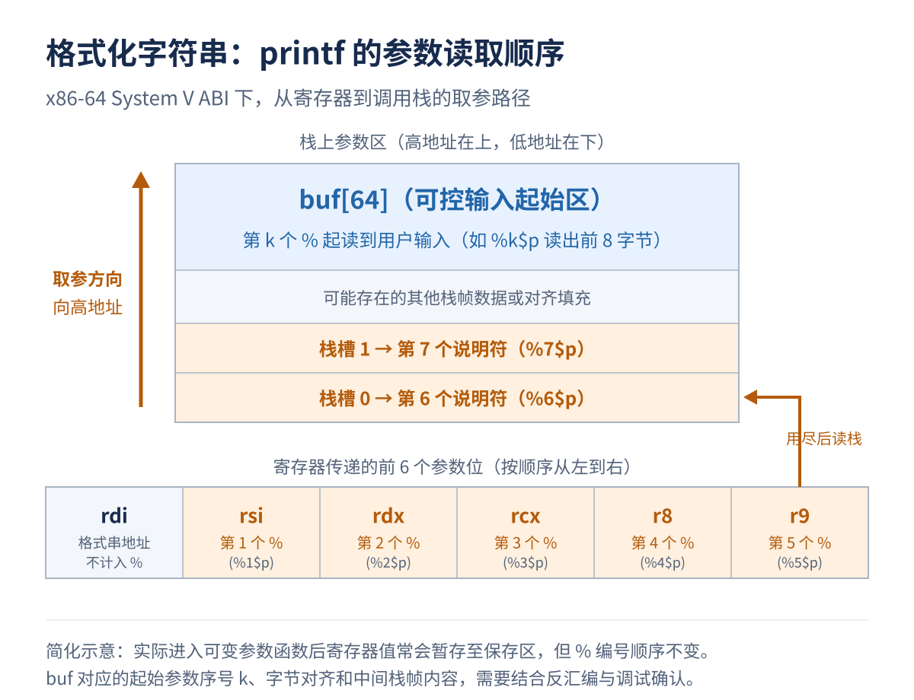
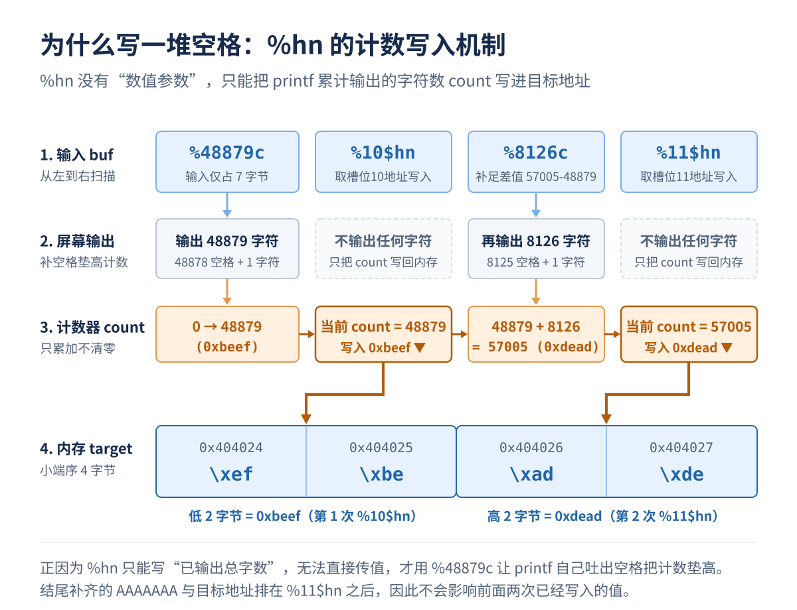

## 什么是格式化字符串漏洞

本文中的“格式化字符串漏洞”指的是**格式化字符串注入（Format String Vulnerability）**：程序将外部可控的数据直接作为格式化函数的格式字符串参数传入，使输入中的格式说明符被解析，进而触发非预期的内存读取或写入。

例如下面这个函数：

```c
#include <stdio.h>
#include <unistd.h>

void vuln(void)
{
    char buf[64];
    ssize_t n = read(0, buf, sizeof(buf) - 1);
    if (n <= 0)
    {
        return;
    }
    buf[n] = '\0';
    printf(buf);
}
```

这段代码的本意是把输入原样打印出来，但调用 `printf` 时直接把 `buf` 当成了第一个参数，也就是格式字符串。

输入普通字符时，程序表现正常；一旦输入里出现 `%p`、`%s`、`%n` 等说明符，`printf` 就会把它们当作解析指令，读取或改写后续参数对应的内存。

这可能导致栈或进程内存中的敏感数据泄露，或触发段错误使程序崩溃；若输入内容与可读写的参数槽位配合，还可能改写关键变量、函数指针甚至劫持程序执行流程。

## 格式化字符串漏洞的原理

### printf 怎样越界取值

`printf` 是可变参数函数，原型为 `int printf(const char *format, ...)`。运行时它不知道调用方实际传了几个参数，只会顺序扫描 `format`：遇到普通字符就输出；每遇到一个 `%` 说明符，就按当前架构的调用约定去取下一个参数。

以 x86-64 System V ABI 为例，前 6 个整型或指针参数依次通过 `rdi`、`rsi`、`rdx`、`rcx`、`r8`、`r9` 传递，第 7 个及之后的参数依次压在栈上。对于 `printf(buf)`，`rdi` 存放格式串 `buf` 的地址，其余位置并未传参，因此说明符会依次读到：

- 第 1 到第 5 个说明符：读取 `rsi`、`rdx`、`rcx`、`r8`、`r9` 中的残留值；
- 第 6 个说明符起：越过寄存器，从调用 `printf` 时的栈顶开始由低地址向高地址读取栈上数据。



图中下方按传参顺序列出寄存器参数位，上方为栈上参数区（高地址在上、低地址在下）。实际编译后，可变参数函数通常会在序言中把寄存器参数保存到专门的保存区再步进读取，但从调用外部看到的逻辑编号不变。实际从第几个参数序号 `k` 开始读到 `buf` 自身内容，需要结合调试或回显确认。

### 常见说明符怎样引发读和写

glibc 等运行库还支持位置参数语法 `%k$...`，可直接指定操作第 `k` 个参数（不要把顺序说明符 `%p` 和位置说明符 `%k$p` 混在同一条格式串中）：

- **`%p` / `%x`（按值读取）**：直接将对应参数槽位里的数值按十六进制打印出来，不做解引用。
- **`%s`（按指针读取）**：把对应槽位的值当作地址，从该地址起连续读取字符直到 `'\0'`。若不是有效可读地址，程序会崩溃。
- **`%n`（按指针写入）**：不输出任何字符，而是将**截至当前 `printf` 累计输出的字节总数**写入对应槽位指向的地址。配合 `hh`（`%hhn` 写 1 字节）或 `h`（`%hn` 写 2 字节）可控制写入宽度。

这里需要区分**物理栈偏移**与**格式化参数序号 `k`**：前者是局部变量 `buf` 距离当前 `rsp` 的字节数，后者是 `printf` 按 ABI 从寄存器到栈顺序计数时 `buf` 对应的 `%k$` 编号。两者之间除了 5 个寄存器参数位外，还隔着返回地址、保存的栈帧或对齐填充，因此仅看源码 `char buf[64]` 无法直接推算 `k`。

## 如何定位参数偏移

动手测偏移之前，先确认输入点与漏洞点之间的约束：格式串输出能否回显给用户、最多能输入多少字节、输入函数是否会在 `'\n'` 或 `'\0'` 处截断（如 `fgets` 读到换行停止、`strcpy` 遇到 `\0` 截断），以及漏洞点是否允许循环多次触发。

起始参数序号 `k` 并非固定值，它会随局部变量的个数和编译器栈对齐方式而变化，常用两种方式确认：

**方式一：有回显时发特征串实测**

向 `vuln()` 输入 `AAAAAAAA.%p.%p.%p.%p.%p.%p.%p.%p`，观察输出：

```text
AAAAAAAA.0x7fff03a12a70.0x7fff03a12a70.(nil).0x722afb604b20.(nil).0x4141414141414141.0x252e70252e70252e.0x2e70252e70252e70
```

从第一个 `.` 后开始数：前 5 个是寄存器残留值，第 6 个出现 `0x4141414141414141`（即开头的 8 个 `A`），因此这里 `k = 6`。若输入长度受限，可直接用 `%6$p`、`%7$p` 逐个试探。

如果 `0x41414141...` 横跨在两个槽位之间（例如输出 `0x4141414100007fff`），说明 `buf` 起始地址未按 8 字节对齐。在输入最前面补齐对应字节数（如 4 个 `A`）后，后续内容即可从下一槽位完整对齐开始。

**方式二：从栈偏移推算或调试数栈槽**

在反编译或调试中确认 `buf` 距离栈顶 `rsp` 的偏移后（例如 `[rsp+0h]` 或 `[rsp+10h]`），套用 **`k = 6 + 栈偏移 / 8`** 即可算出起始槽位。上面的 `vuln()` 之所以实测为 `6`，就是因为 `buf` 紧贴栈顶（`[rsp+0h]`）。

在 `call printf` 处下断点可直接验证：`rsp` 指向的位置就是 `%6$`，往下每 8 字节依次对应 `%7$`、`%8$`……对照 `&buf` 所在行就能确定 `k`。

## 如何构造任意读与任意写

当 `k >= 6` 时，栈上的 `buf` 同时充当“格式控制串”和“参数槽位”。由于 x86-64 用户态地址高位包含 `\x00`，把地址放在开头会截断格式串；因此实际构造时一律**把格式说明符和对齐填充放前面，把目标地址放末尾**。

通用槽位换算规律：若对齐后的起点为 `k`，前面的格式串加上对齐填充共占 `m` 个 8 字节槽位，则末尾放置的第 1 个地址对应 `%(k + m)$`，第 2 个对应 `%(k + m + 1)$`。下面沿用上文测得的 `k = 6` 举例。

### 任意地址读（%k$s）

拿到偏移后，就可以读取进程中已知地址的内容。假设程序在 `.rodata` 段（或内存某处）存有一串待读取的数据——在关闭 PIE 或已泄露基址时，能在 IDA 里直接看到它的地址，这里以位于 `0x402008` 的静态字符串 `"secret_data"` 为例。

构造时要先把前面的槽位填满对齐。`buf` 里存的是还未解析的原始字节：`"%7$s"` 占 4 字节，再补 `"AAAA"` 占 4 字节，凑足 **8 字节**填满 `buf[0..7]`（`%6$`），紧跟的小端序地址 `p64(0x402008)` 便完整落入 `buf[8..15]`（`%7$`）：

```text
buf[0..7]  (槽位 %6$): "%7$sAAAA"                     (4 + 4 = 8 字节)
buf[8..15] (槽位 %7$): \x08\x20\x40\x00\x00\x00\x00\x00  (p64(0x402008))
```

```python
payload = b"%7$sAAAA" + p64(0x402008)
```

`printf` 先解析 `%7$s` 解引用 `0x402008` 输出 `secret_data`，再原样打印 `AAAA` 及地址中的可见字符 `\x08\x20\x40`，遇到高位 `\x00` 停止，最终输出 `secret_dataAAAA  @`。实战中常把 `"AAAA"` 换成 `"END_"` 之类的分隔标记方便脚本切片。

### 任意地址写（%hn 与计数器机制）

除了读出数据，实战中更常需要修改程序里的关键变量或 GOT 表项。假设在 IDA 中看到 `.bss` 段存在一个控制分支的全局变量 `target`（位于 `0x404024`），需要把它改成 `0xdeadbeef`。说到改写，初学者常疑惑：**为什么不直接写值，非要用 `%48879c` 输出上万个空格？**

因为 **`%n` / `%hn` 不接收“要写的值”作为参数**。`printf` 内部有一个累计输出字符计数器 `count`（初始为 0，每打印 1 个字符加 1），遇到 `%hn` 时，它唯一能写入内存的就是**当前 `count` 的低 16 位**。C 格式化语法无法直接传入常数写入，所以只能靠宽度修饰符 `%48879c`（输入仅占 7 字节），逼着 `printf` 吐出 48878 个空格和 1 个字符，把 `count` 垫高到 `48879`。

直接输出 37 亿（`0xdeadbeef`）个字符不现实，因此拆成两次 2 字节写入（`%hn`）。按小端序，`0xdeadbeef` 在内存中为 `\xef\xbe\xad\xde`：

- 低 2 字节（`0x404024`）：目标值 `0xbeef = 48879`；
- 高 2 字节（`0x404026`）：目标值 `0xdead = 57005`，在已有计数基础上再补 `57005 - 48879 = 8126` 字节即可。



如上图所示，同一条 `printf` 中 `count` 只增不减：执行 `%48879c%10$hn` 将 `0xbeef` 写入 `0x404024` 后，再用 `%8126c%11$hn` 将 `count` 推到 `57005` 并把 `0xdead` 写入 `0x404026`，拼成完整的 `0xdeadbeef`。

前缀 `"%48879c%10$hn%8126c%11$hn"` 长 25 字节，向 8 字节边界补 7 个 `'A'` 凑到 32 字节（占满 `%6$`~`%9$` 共 4 个槽位），两个目标地址落在 `%10$` 和 `%11$`：

```text
buf[0..31]  (槽位 %6$ ~ %9$): "%48879c%10$hn%8126c%11$hnAAAAAAA"  (25 + 7 = 32 字节)
buf[32..39] (槽位 %10$):      p64(0x404024)                       (8 字节)
buf[40..47] (槽位 %11$):      p64(0x404026)                       (8 字节)
```

```python
payload = b"%48879c%10$hn%8126c%11$hn".ljust(32, b"A") + p64(0x404024) + p64(0x404026)
```

若高 2 字节数值小于低 2 字节（如写入 `0x12345678`），可把较小值排在前面先写，或者利用 `%hn` 对 `0x10000` 取模回绕的特性补输出 `0x10000 + 目标值 - 当前count` 个字符。

如果 `buf` 不在栈上（例如位于 `.bss` 或堆区），输入无法直接落入栈参数槽位，也就不能把目标地址直接塞进 `%k$`。这种非栈格式化字符串漏洞通常需要**借助栈上已有的指针链做两跳写入**：在栈上找一对原本就存在指向关系的槽位（例如保存的 `rbp` 链：`槽位 A -> 槽位 B`），第一轮用 `%A$hn` 修改槽位 B 的内容指向目标地址（如先改低 2 字节指向返回地址或 GOT 表），第二轮再用 `%B$hn` 往该目标地址写入最终值。

### 用 fmtstr_payload 自动生成

写完整的 64 位地址时手算 4 段 `%hn` 或 8 段 `%hhn` 容易出错，实战中通常用 pwntools 的 `fmtstr_payload` 自动生成对齐后的 payload：

```python
payload = fmtstr_payload(offset, writes, numbwritten=0, write_size='byte')
```

- `offset`：对齐后的起始参数序号 `k`。
- `writes`：`{目标地址: 目标值}` 字典，支持同时写多个地址，如 `{elf.got["printf"]: system_addr}`。
- `numbwritten`：可控输入前，本次 `printf` 已提前输出的固定字节数（没有前缀则填 `0`）。
- `write_size`：写入粒度，默认 `'byte'`（`%hhn`，按 1 字节写）；遇到输入长度卡得很紧时，可改成 `'short'`（`%hn`，按 2 字节写）减少分段和末尾地址数量，或只修改目标地址变化的低 2\~4 字节。

## 保护机制与漏洞修复

### 常见保护机制的影响

| 机制 | 主要作用及其影响 |
| --- | --- |
| RELRO | Partial RELRO 下 GOT 表可写；Full RELRO 会在启动时解析并把 GOT 表设为只读，限制 GOT 表劫持。 |
| ASLR / PIE | 随机化栈、libc 与主程序基址，改写目标前通常需要先用 `%k$p` 或 `%k$s` 泄露地址。 |
| Canary | 检测连续栈覆盖，不阻止格式化字符串本身读写；反而常可先被 `%k$p` 泄露出值。 |
| 编译与运行库检查 | `-Wformat -Wformat-security` 可在编译期拦截非常量格式串；部分强化环境（如 `_FORTIFY_SOURCE`）会在特定条件下禁用 `%n`。 |

调试验证时，建议在 `call printf` 前后核对三件事：探测出的 `k` 是否稳定、目标地址是否完整落进预期 8 字节槽位、以及写入前后目标内存的十六进制值是否按预期变化。如果执行到 `%s` 或 `%n` 时触发段错误崩溃，常见原因有三个：槽位编号数错（取到了寄存器或无关栈数据）、前缀未按 8 字节对齐导致地址被拆半、或者目标地址本身位于不可读/不可写内存段（例如开启 Full RELRO 后尝试写 GOT 表）。

### 怎样修复这个漏洞

修补的关键是把外部输入严格限定为普通数据，显式提供常量格式串：

```c
#include <stdio.h>
#include <unistd.h>

void safe(void)
{
    char buf[64];
    ssize_t n = read(0, buf, sizeof(buf) - 1);
    if (n <= 0)
    {
        if (n < 0)
        {
            perror("read");
        }
        return;
    }
    buf[n] = '\0';
    printf("%s", buf);
}
```

将 `printf(buf)` 改为 `printf("%s", buf)` 后，即使 `buf` 内含 `%p` 或 `%n` 也只会原样输出。不需要格式化功能时，也可以直接改用 `fputs(buf, stdout)`。建议编译时加上 `-Wformat -Wformat-security -Werror=format-security`，在构建阶段直接拦截此类问题。

## 常见利用思路

### 信息泄露

- **读栈数据（`%k$p`）**：泄露出栈上残留的 Canary、返回地址、栈指针或 libc 指针，用于反推 PIE 或 libc 基址。
- **任意地址读（`%k$s`）**：读取指定地址上的内容，常用于读取已解析的 GOT 表项以直接获取 libc 函数真实地址。

### 内存改写

- **改写程序变量**：修改决定程序分支的全局标志位或局部变量。
- **改写 GOT 表（Partial RELRO）**：把后续会调用的库函数 GOT 表项（如 `printf@got`）改写为 `system` 或 one_gadget。例如把 `printf@got` 改成 `system` 后，下一轮输入 `"/bin/sh"` 调用 `printf(buf)` 就会执行 `system("/bin/sh")`。
- **改写返回地址（Full RELRO）**：GOT 表只读时，先泄露栈地址算出返回地址位置，再用 `%n` 分段覆盖返回地址跳转到目标代码或 ROP 链。

对于开启 Partial RELRO、关闭 PIE 且存在循环触发的二进制（假设测得 `k = 6`），标准三步利用流程为：

1. **泄露 libc**：发送 `"%7$sEND_" + p64(elf.got["puts"])`，解包出 `puts` 真实地址并算出 `libc_base` 和 `system` 地址。
2. **改写 GOT**：发送 `fmtstr_payload(6, {elf.got["printf"]: system_addr}, write_size="short")`，将 `printf@got` 改写为 `system`（高版本 glibc 下执行 `system` 需注意调用点栈按 16 字节对齐，若意外崩溃可排查调用前栈帧或改用 `one_gadget` / 栈迁移）。
3. **获取 Shell**：下一轮输入 `"/bin/sh\x00"`，程序调用 `printf(buf)` 时触发 `system("/bin/sh")`。
